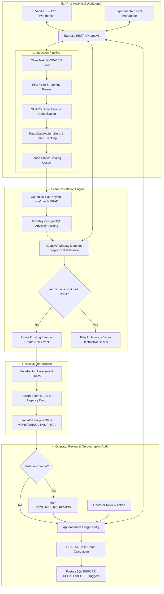

# Europa System Architecture

Europa is an analytical space situational awareness (SSA) workbench and backend service. It ingests public satellite close-approach predictions, correlates observations into persistent encounter events over time, tracks prediction evolution, computes transparent review priorities, maintains an immutable cryptographic audit ledger, and supports experimental SGP4 orbital trajectory screening.

This document describes the architectural design, data pipelines, domain models, and key architectural decisions of the Europa system.

---

## 1. Architectural Overview & Data Flow

Europa is structured as a modular Node.js monolith with an isolated PostgreSQL relational persistence layer and a zero-dependency vanilla web workbench.

---

## 2. Ingestion Pipeline & Provenance

The ingestion pipeline handles raw public close-approach datasets (such as CelesTrak SOCRATES snapshots) and ensures data integrity, deduplication, and provenance tracking.

### 2.1 Streaming CSV Parser (`src/modules/ingestion/socratesParser.js`)

- **RFC 4180 Compliance:** Parses comma-separated values with quoted fields and escaped commas.
- **Header Normalization:** Maps diverse public column aliases (`NORAD_CAT_ID_1`, `OBJECT_NAME_1`, `DSE_1`, `TCA`, `TCA_RANGE`, `TCA_RELATIVE_SPEED`, `MAX_PROB`, `DILUTION`) to normalized internal representations.
- **Scientific Notation & Validation:** Converts floating-point values in exponential format (e.g., `1.200E-05`) and parses fractional day offsets (`DSE`, Days Since Epoch). Rejects malformed rows with line-indexed error summaries while continuing to parse valid entries.
- **Memory Bounded:** Uses Node.js streams to process multi-thousand-row snapshots within strict memory boundaries.

### 2.2 Snapshot Idempotency & Provenance (`src/modules/ingestion/ingestionService.js`)

- **Content Checksumming:** Computes a SHA-256 digest of incoming snapshot bytes.
- **Idempotency Strategy:** Queries `ingestion_batches` for existing batches matching `content_sha256`. If an identical snapshot was previously completed with the same captured timestamp, the engine rejects duplicate ingestion with status `DUPLICATE_IGNORED`, avoiding redundant processing while preserving provenance.
- **Subsequent Poll Handling:** If an upstream query returns unchanged content during a scheduled poll, the engine records a `SUPERSEDED_UNMODIFIED_POLL` batch record without creating duplicate raw observation rows.
- **Raw Observation Archive:** Stores original, unaggregated observations in `raw_observations`, referencing `batch_id`, source line index, capture time, and raw fields.

---

## 3. Event Correlation Engine

The correlation engine (`src/modules/correlation/correlatorService.js`) groups observations from successive snapshots into persistent, stable encounter events (`conjunction_events`).

### 3.1 Canonical Pair Identity

Satellite close approaches involve two objects. In raw reports, object order is arbitrary: Object A may appear as Primary in one snapshot and Secondary in the next.

- Europa enforces canonical pair keying:
  $$\text{primary\_object\_id} = \min(\text{norad}_1, \text{norad}_2)$$
  $$\text{secondary\_object\_id} = \max(\text{norad}_1, \text{norad}_2)$$
  $$\text{canonical\_pair\_key} = \text{primary\_object\_id} : \text{secondary\_object\_id}$$

### 3.2 Two-Key Advisory Locking

To guarantee serial consistency across concurrent worker processes without locking the entire table:

- Europa executes `pg_advisory_xact_lock(primary_id, secondary_id)` at the start of correlation for each pair.
- Locks are scoped strictly to the current database transaction and automatically released on `COMMIT` or `ROLLBACK`.
- Concurrent ingestion streams processing different satellite pairs execute in parallel; streams processing the same pair serialize safely, eliminating duplicate event formation.

### 3.3 Heuristic Matching Policy (`src/modules/correlation/matchingPolicy.js`)

When an observation arrives for a canonical pair, candidate events are evaluated:

1. **Active Tracking Window:** The event must be in an active tracking state (`ACTIVE_TRACKING` or `AMBIGUOUS`).
2. **Step Tolerance:** The absolute difference between the candidate observation's TCA and the event's latest TCA must not exceed the configured step tolerance (default: 20 minutes):
   $$|\text{TCA}_{\text{obs}} - \text{TCA}_{\text{latest}}| \le \Delta t_{\text{step}}$$
3. **Cumulative Drift Ceiling:** The absolute difference between the candidate observation's TCA and the event's initial TCA must not exceed the cumulative drift limit (default: 45 minutes):
   $$|\text{TCA}_{\text{obs}} - \text{TCA}_{\text{initial}}| \le \Delta t_{\text{max\_drift}}$$

### 3.4 Ambiguity & Out-of-Order Safety

- **Intra-Snapshot Disambiguation:** If a single snapshot contains multiple close approaches for the same object pair (e.g., repeating orbits), each approach is correlated independently. If ambiguity cannot be resolved deterministically, the event is marked `tracking_state = 'AMBIGUOUS'`.
- **Out-of-Order Backfilling:** Delayed or historical snapshots that arrive out of sequence are ingested non-destructively: the observation is inserted at its correct position in `event_observations` by `chronological_sequence`, and the event's summary metrics (`min_predicted_range_km`, `observation_count`) are updated without overwriting newer latest predictions.

---

## 4. Assessment Engine & Lifecycle

The assessment engine (`src/modules/assessment/assessmentEngine.js`) evaluates conjunction events using an explainable, multi-factor heuristic model.

### 4.1 Scoring Formula & Weights (`src/modules/assessment/assessmentRules.js`)

The priority score is calculated on a 0–100 scale across four weighted components:

$$\text{Score} = S_{\text{range}} + S_{\text{time}} + S_{\text{prob}} + S_{\text{freshness}}$$

| Component                                    | Maximum Score | Evaluation Criteria                                                                                                                        |
| :------------------------------------------- | :-----------: | :----------------------------------------------------------------------------------------------------------------------------------------- |
| **Miss Distance ($S\_{\text{range}}$)**      |    **50**     | $<0.5\text{ km} \to 50$, $<1.0\text{ km} \to 40$, $<2.0\text{ km} \to 30$, $<5.0\text{ km} \to 15$, $\ge 5.0\text{ km} \to 5$              |
| **Time to TCA ($S\_{\text{time}}$)**         |    **30**     | $<12\text{ h} \to 30$, $<24\text{ h} \to 24$, $<48\text{ h} \to 18$, $<72\text{ h} \to 10$, $<168\text{ h} \to 5$, $\text{past TCA} \to 0$ |
| **Screening Metric ($S\_{\text{prob}}$)**    |    **15**     | $\text{MAX\_PROB} \ge 10^{-2} \to 15$, $\ge 10^{-3} \to 12$, $\ge 10^{-4} \to 9$, $\ge 10^{-5} \to 6$, $<10^{-5} \to 2$                    |
| **Data Freshness ($S\_{\text{freshness}}$)** |     **5**     | Both DSE $\le 1.0\text{ d} \to 5$, both $\le 2.0\text{ d} \to 3$, either $>2.0\text{ d} \to 1$                                             |

### 4.2 Urgency Classification

Events are categorized into four operational tiers:

- **`CRITICAL`**: Score $\ge 75$, or triggered by a **Proximity Override** (miss distance $<0.5\text{ km}$ and time to TCA $\le 24\text{ hours}$).
- **`HIGH`**: Score $\ge 50$ and $<75$.
- **`MEDIUM`**: Score $\ge 25$ and $<50$.
- **`LOW`**: Score $<25$.

### 4.3 Lifecycle Management (`src/modules/lifecycle/lifecycleManager.js`)

Events transition across lifecycle states:

- **`MONITORING`**: Active close approach where predicted TCA is in the future.
- **`PAST_TCA`**: The predicted TCA has passed relative to the system reference clock.
- **`CANCELLED`**: An event discarded or superseded by updated upstream tracking.

---

## 5. Operator Review & Cryptographic Audit Ledger

Europa provides an auditable human-in-the-loop review workflow backed by a cryptographic ledger (`src/modules/audit/auditLedger.js`).

### 5.1 Decoupled State Dimensions

To prevent confusing human administrative actions with algorithmic calculations, Europa strictly decouples three independent dimensions:

1. `lifecycle_state`: Temporal state (`MONITORING`, `PAST_TCA`).
2. `urgency_level`: Algorithmic review priority (`LOW`, `MEDIUM`, `HIGH`, `CRITICAL`).
3. `review_status`: Human operator disposition (`PENDING`, `ACKNOWLEDGED`, `ESCALATED`, `DISMISSED`, `REQUIRES_RE_REVIEW`).

### 5.2 Automated Re-Review Triggers (`src/modules/review/reviewService.js`)

If an operator has previously reviewed an event (`ACKNOWLEDGED` or `DISMISSED`), the event automatically resets to `REQUIRES_RE_REVIEW` when a new observation arrives with:

- Predicted miss distance contracting by $\ge 20\%$.
- Urgency tier elevating (e.g., `MEDIUM` to `HIGH` or `CRITICAL`).
- Time to TCA dropping under 24 hours.

### 5.3 Cryptographic Hash Chain

Every major state transition creates an entry in `audit_ledger`:

- **Hash Formula:**
  $$\text{entry\_hash} = \text{SHA-256}(\text{seq} \parallel \text{id} \parallel \text{event\_id} \parallel \text{action} \parallel \text{actor\_type} \parallel \text{actor\_id} \parallel \text{prev\_hash} \parallel \text{payload} \parallel \text{created\_at})$$
- **Genesis Block:** Entry sequence #1 has `prev_hash` set to 64 zeros (`0000...0000`).
- **Database Trigger Enforcement:** PostgreSQL `BEFORE UPDATE OR DELETE` triggers unconditionally reject mutations on `audit_ledger`, making the table strictly append-only.
- **Read-Only Verification:** `GET /api/v1/audit/verify` iterates through all entries, recomputes each hash, and verifies chain continuity from genesis to head.

---

## 6. Experimental SGP4 Orbital Screening

Europa includes an integrated orbital propagation module (`src/modules/propagation/`) for experimental trajectory analysis.

### 6.1 SGP4 Propagation Engine (`src/modules/propagation/sgp4Propagator.js`)

- Uses `satellite.js` (Vallado SGP4 implementation) to propagate two-line element sets (TLEs) into Earth-Centered Inertial (ECI / TEME) coordinates.
- Calculates instantaneous position vectors $\mathbf{r}(t)$ and velocity vectors $\mathbf{v}(t)$.

### 6.2 Encounter Refinement (`src/modules/propagation/encounterEstimator.js`)

1. **Coarse Search:** Propagates both satellites across a configurable search window (default: $\pm 10$ minutes) around the nominal TCA at a coarse time step (default: 5 seconds).
2. **Fine Search:** Identifies the minimum coarse distance and performs a high-resolution sweep with a 100-millisecond step ($\pm 10$ seconds around the coarse minimum).
3. **Computed Metrics:** Determines refined TCA, minimum miss distance (km), and relative encounter velocity (km/s).

### 6.3 TLE Validation & Freshness (`src/modules/propagation/tleValidator.js`)

- Validates line length (69 characters), line number prefixes, and modulo-10 checksums.
- Extracts epoch timestamps and flags orbital elements older than 72 hours relative to the screening epoch.

---

## 7. REST API & Web Workbench

### 7.1 Express REST API (`src/api/`)

- Mounted under `/api/v1`.
- Uniform JSON envelopes for all responses: `{ success: true, data: ..., pagination: ... }` or `{ success: false, error: { code, message, details } }`.
- Operator authentication via `X-API-Key` or `Authorization: Bearer <key>` header on all mutating endpoints (`/ingest/snapshots`, `/events/:id/reviews`, and persisted `/propagation/estimate`).
- Input validation middlewares enforcing parameter formats, types, and allowed enumeration values.

### 7.2 Analytical Web Workbench (`public/`)

- Built using zero-framework vanilla JavaScript (ES modules), HTML5 semantic markup, and custom CSS custom properties (design tokens).
- Client-side reactive state manager (`public/js/state.js`) using a publisher-subscriber pattern.
- In-memory operator credentials: Keys entered via the modal are kept strictly in transient JavaScript memory and are never persisted to `localStorage`, `sessionStorage`, or cookies.
- Live SVG range evolution charts rendered directly in the DOM without external charting dependencies.
